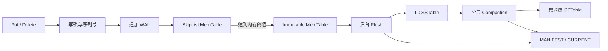

# MapleDB：简历项目描述与技术梳理

## 1. 项目定位

**项目名称：MapleDB——基于 LSM-Tree 的嵌入式键值存储引擎**

**技术栈：C++17、LSM-Tree、SkipList、Arena、WAL、SSTable、分片 LRU、POSIX I/O、CMake、CTest、ASan/UBSan。**

参考 LevelDB 的存储架构，实现从内存写入、日志记录、后台落盘、分层压缩到查询与有序迭代的完整基础链路，并建立与 LevelDB 1.23 的可复现性能对比。
项目适合展示 C++ 系统编程、存储引擎、并发与资源管理、性能实验设计能力。

## 2. 可直接用于简历的版本

### MapleDB｜基于 LSM-Tree 的键值存储引擎

**技术栈：C++17 / SkipList / WAL / SSTable / 分片 LRU / 多线程 / CMake**

- 参考 LevelDB 实现 LSM 存储引擎，支持 Put/Get/Delete 与有序迭代；构建 WAL、SkipList + Arena MemTable、SSTable 和 MANIFEST，完成双 MemTable 切换、后台 Flush、分层 Compaction 与重启恢复。
- 实现 TableCache/BlockCache 与 16 分片 LRU，通过引用计数 handle 管理缓存对象；缓存命中直接复用 Block，使用 pread 支持并发块读取，并接入按 user key 构建的 Bloom Filter，在读取 DataBlock 前排除无效查询。
- 基于序列号实现版本可见性、删除标记过滤和迭代器创建时视图；采用不可变文件元数据快照保留活跃读所需 SST，结合 L0 多路合并与 L1+ 按需连接完成全局有序扫描。
- 构建统一 benchmark 对比 LevelDB 1.23，在相同 10 万/100 万条数据、7 类负载下，交替测量 Bloom 关闭/开启，各 5 轮；百万条数据下 Bloom 使不存在键查询吞吐提升 48.8%，达到约 255 万次/秒，两边开启时 LevelDB 约 235 万次/秒；校验全部读取结果，Debug/Release 各 16 项测试及 ASan/UBSan 存储与 Bloom 回归通过。

**性能条件说明**：Apple M3 Pro，单前台线程，16 B key + 100 B value，8 MiB 显式 BlockCache，无块压缩；Bloom 0/10 bits/key，读前预热，取 5 轮中位数。简历中保留“不存在键查询”和测试条件，完整结果放在仓库性能报告中。

## 3. 关键架构：如何解释整个项目

### 写入与后台处理



1. 写入先追加 WAL，再插入 MemTable，成功后发布序列号。当前 Put 会 fflush WAL，但没有逐条同步设备。
2. MemTable 使用 SkipList 保存有序 InternalKey，Arena 集中分配键值与节点内存。
3. MemTable 达到阈值后切换为 immutable，前台使用新 MemTable，后台把旧表写为 SST。
4. 如果 immutable 尚未处理完，后续内存切换需要等待条件变量；后台完成或失败后唤醒等待者。
5. Compaction 合并相邻层文件，去掉被覆盖的旧版本，并在检查更深层后决定是否可以丢弃删除标记。
6. SST 完成并同步后，通过 MANIFEST 更新文件集合；CURRENT 指向当前 MANIFEST。

### 点查路径

```text
Get(key)
  ├─ 获取当前序列号、MemTable 引用及文件元数据快照
  ├─ MemTable → Immutable MemTable
  └─ SSTable
       ├─ L0：范围筛选，优先查询新文件
       ├─ L1+：二分查找候选文件
       └─ TableCache → IndexBlock → Bloom Filter
                                      ├─ 不可能存在：结束该 SST 查询
                                      └─ 可能存在/无过滤器 → BlockCache
                                                            ├─ hit：复用 Block
                                                            └─ miss：pread 读取数据块
```

查询持有必要的内存表和文件版本引用。后台压缩安装新文件集合后，旧集合中的文件仍可被活跃读和迭代器使用，GC 会保留这些文件。

### 有序迭代

```text
MemTableIterator + ImmutableIterator
              + L0 各 SST 的两级迭代器
              + L1+ 每层的按需连接迭代器
                         ↓
                 MergingIterator
                         ↓
                       DBIter
          按创建时序列号过滤，去重并跳过删除标记
```

两级 SST 迭代器先定位 IndexBlock，再定位 DataBlock。L1+ 文件范围互不重叠，每层按顺序打开当前需要的文件；L0 可能重叠，需要合并独立输入。
当前合并器通过扫描有效子迭代器选择最小键，单次选择成本为 O(k)，k 为输入数量。

## 4. 关键技术及代码证据

| 技术 | 实现与用途 | 代码入口 |
|---|---|---|
| LSM 与后台处理 | 内存写入转为顺序落盘，双 MemTable，条件变量等待，分层 Compaction | [dbimpl.cpp](../src/db/dbimpl.cpp) |
| SkipList 并发可见性 | 外部锁串行化插入；后继指针 release 发布、acquire 读取；节点存活期间支持并发读 | [skiplist.h](../src/db/skiplist.h) |
| Arena 内存管理 | 对齐与批量分配，随 MemTable 统一回收，减少逐节点分配 | [arena.cpp](../src/util/arena.cpp)、[memtable.cpp](../src/db/memtable.cpp) |
| InternalKey | user_key 升序、序列号降序，操作类型区分 value/deletion | [dbformat.h](../src/db/dbformat.h) |
| SSTable 格式 | DataBlock、IndexBlock、Footer，键前缀编码、Varint、Restart Point 支持 Seek | [blockbuilder.cpp](../src/table/blockbuilder.cpp)、[block.h](../src/table/block.h) |
| WAL 与恢复 | 分块和分片记录、CRC32 校验、WriteBatch 编码与重放、文件号管理 | [logwriter.cpp](../src/db/logwriter.cpp)、[logreader.cpp](../src/db/logreader.cpp) |
| 分片 LRU | 16 个分片，哈希定位、独立互斥锁，区分正在使用与可淘汰条目 | [cache.cpp](../src/util/cache.cpp) |
| Bloom Filter | 按 2 KiB 文件区间构建，使用 user key，包含删除标记；MetaIndex 定位，CRC/格式异常时回退 | [filter_block.cpp](../src/table/filter_block.cpp)、[bloom.cpp](../src/util/bloom.cpp) |
| 缓存生命期 | handle 引用计数；迭代器 cleanup 在销毁时释放 Table，持有 DataBlock handle | [tablecache.cpp](../src/db/tablecache.cpp)、[table.cpp](../src/table/table.cpp) |
| 文件版本与 GC | 不可变元数据集合，活跃版本持有旧 SST，避免压缩后的文件删除影响读 | [versionset.cpp](../src/db/versionset.cpp) |
| 用户迭代器 | 创建时序列号可见性、版本去重、删除标记过滤、多路合并 | [dbiterator.cpp](../src/db/dbiterator.cpp)、[mergeiterator.cpp](../src/db/mergeiterator.cpp) |
| 可复现 benchmark | 同一数据与请求生成器、同一计时循环、结果校验、分离前台和后台耗时 | [compare_benchmark.cpp](../benchmarks/compare_benchmark.cpp) |

## 5. 性能测试与 LevelDB 对比

### 实验设计

以下基线表保留 Bloom 接入前的结果。接入后已用同一份当前源码完成开关各 5 轮的新实验，完整数字见 [Bloom 对比报告](performance/bloom/comparison.md)；新功能收益使用新实验自身的关闭组计算。

- 固定 LevelDB 1.23，两个库都以 C++17、Release、`-O2` 编译，使用同一个 benchmark 可执行文件。
- 数据规模为 10 万和 100 万条；数据及请求在计时外生成，两边共享完全相同的内容与顺序。
- 配置 4 MiB WriteBuffer、4 KiB DataBlock、2 MiB SST 目标大小、restart interval=16、8 MiB 显式 BlockCache。
- 测试顺序写、随机写、顺序 Get、随机 Get、热点 Get、不存在键 Get、全量扫描，共 7 类负载。
- 每种规模各 5 轮，交替运行两个引擎，报告中位数、最小/最大值和抽样延迟。
- 写入分别报告 Put 返回速度及加上最终 Flush/自然压缩的完整成本；读取单独预热一次再计时。
- 所有点查校验完整 value，扫描校验 key/value、顺序、数量和最终状态；汇总脚本校验 70 对结果一致。

### 百万条无过滤器历史基线

| 工作负载 | MapleDB 中位吞吐量 | LevelDB 中位吞吐量 | 结论 |
|---|---:|---:|---|
| 顺序写，Put 返回 | 29.31 万次/s | 41.89 万次/s | LevelDB 约 1.43× |
| 随机写，Put 返回 | 19.61 万次/s | 26.45 万次/s | LevelDB 约 1.35× |
| 顺序写，包含 Flush/压缩 | 27.77 万次/s | 41.64 万次/s | LevelDB 约 1.50× |
| 随机写，包含 Flush/压缩 | 14.89 万次/s | 24.92 万次/s | LevelDB 约 1.67× |
| 预热顺序 Get | 172.48 万次/s | 158.11 万次/s | MapleDB 约高 9% |
| 预热随机 Get | 41.84 万次/s | 77.37 万次/s | LevelDB 约 1.85× |
| 预热热点 Get | 158.94 万次/s | 153.05 万次/s | 中位数接近，范围有重叠 |
| 预热不存在键 Get | 166.61 万次/s | 158.68 万次/s | 此访问模式下 MapleDB 略高 |
| 预热全量扫描 | 986.85 万条/s | 1636.15 万条/s | LevelDB 约 1.66× |

### 如何解释差距

**随机读**：百万条 SST 约 110 MiB，超过 8 MiB 显式缓存。MapleDB miss 后需要 pread、分配缓冲区并读入整个块；LevelDB 默认 POSIX 后端可以尝试 mmap，未压缩映射块避免重复缓存。两边显式缓存参数一致，但实际读路径与总驻留内存仍有区别。

**顺序读与热点读**：顺序请求连续访问同一块，热点集合较小，更容易复用缓存。本次移除了 MapleDB 缓存命中的整块复制，此类访问模式的结果接近或略高于 LevelDB。没有修复前的 benchmark 数据，尚不能量化该修改的提升幅度。

**写入与压缩**：两个引擎保留各自的 MemTable 内存估算、输出层选择、压缩及同步细节。把 Flush 和压缩成本计入后，随机写差距更明显，因此性能分析需要同时覆盖前台和后台工作。

**扫描**：MapleDB 已采用 L1+ 按需连接，但仍需优化块切换、解析和合并等路径；mmap/pread 差异也可能影响结果。目前没有采集调用栈或缓存 miss 数，这些是根据代码提出的解释，具体占比需要 profile。

历史数据和测试条件见 [性能报告](performance/comparison.md)、[数据汇总](performance/summary.md) 和 [原始结果](performance/results.csv)。

### 最新 Bloom 实验

百万条、两边均为 10 bits/key，其他条件同上：

| 负载 | MapleDB 万次/s | LevelDB 万次/s |
|---|---:|---:|
| 预热顺序 Get | 174.16 | 151.90 |
| 预热随机命中 Get | 49.85 | 53.81 |
| 预热热点 Get | 157.58 | 142.88 |
| 预热不存在键 Get | 255.35 | 234.54 |
| 全量扫描，万条/s | 1075.04 | 1599.75 |
| 顺序写，包含 Flush/压缩 | 27.21 | 41.06 |
| 随机写，包含 Flush/压缩 | 14.68 | 24.82 |

同版本关闭 → 开启，MapleDB 不存在键吞吐 +48.8%，LevelDB +44.9%；最终 SST 大小增加约 1.31%。随机命中差距缩小主要伴随 LevelDB 在该配置下下降 35.0%，MapleDB 仅 +3.8% 且范围重叠，不宜写成 Bloom 大幅加速随机命中。详细范围和边界见 [最新报告](performance/bloom/comparison.md) 与 [开关效果](performance/bloom/effects.md)。

## 6. 适合面试展开的工程问题

### 缓存条目淘汰时，正在使用的迭代器怎么办？

迭代器持有缓存 handle。淘汰移除缓存自身引用，使用者引用仍保留对象；迭代器析构后释放 handle，最后一个引用消失时才销毁 Table/Block。TableCache 使用迭代器 cleanup 延迟释放，避免打开迭代器后立即释放 Table。

### 压缩删除旧 SST，为什么活跃读仍能访问？

读与迭代器持有不可变文件元数据快照，GC 收集当前及仍被引用快照中的文件号作为 live 集合。即使迭代器创建后尚未 Seek，旧文件也会保留；只 pin 当前打开的 Table 不能解决延迟打开其他旧文件的问题。

### 条件变量为什么能处理虚假唤醒？

等待放在循环或带谓词的 wait 中，唤醒后重新检查 immutable、后台错误及关闭状态。通知代表状态可能发生变化，实际是否继续由锁内条件决定。

### SkipList 无锁读的边界是什么？

节点通过 release/acquire 发布和读取，插入由外部锁串行化，节点在 MemTable 生命周期内保留。DB::Get 获取序列号和内存表引用时仍会短暂加锁，整个 DB 查询路径并非全程无锁。

### 迭代器如何处理后续覆盖和删除？

创建时记录可见序列号并保留数据源。DBIter 跳过更大的序列号，按 user_key 去重并处理删除标记；内部键比较器保证同一 key 的新版本优先。当前提供创建时视图，尚无公开 Snapshot/事务 API。

### 连续重开为什么可能丢 WAL 尾部数据？

如果第一次恢复只把旧 WAL 重放到内存，却发布了更大的 WAL 编号，第二次恢复可能按新编号过滤掉旧日志。本次先把恢复出的尾部写入 SST，再发布新 WAL，并标记观察到的文件号，避免旧日志被忽略及编号复用。

### 为什么 Get、扫描、前台写入需要分别计时？

顺序 Get 每次重新定位，扫描复用迭代器；二者成本不同。Put 返回后仍可能有内存表和压缩工作未完成，因此还要报告最终 Flush/压缩时间。显式排空后台任务比固定 sleep 更能稳定定义测试结束点。

### 下一步如何优化？

先增加缓存 hit/miss、pread 次数与字节数统计，profile 随机点查和扫描，再决定调整缓存、文件读取或迭代器路径；写入侧记录压缩字节、同步次数与等待时间。Bloom 开关对照已完成，后续定位命中查询成本并追加冷读、更大规模及混合更新场景；文件锁、同步写选项和故障注入可作为后续功能及可靠性工作。

## 7. 当前实现范围

| 领域 | 当前范围 |
|---|---|
| 版本管理 | 内部序列号、删除标记、迭代器创建时视图；公开事务与 Snapshot API 尚未实现 |
| 压缩 | 支持键前缀编码；Snappy 等整块压缩尚未接入 |
| Bloom Filter | 已接入 Flush/Compaction 输出和 SST 点查；默认 10 bits/key，0 关闭，兼容旧 SST |
| 并发 | 外部串行写 SkipList、并发读、后台 Flush/压缩；benchmark 使用单前台线程 |
| I/O | MapleDB 使用 pread；LevelDB 对比保留默认 POSIX 后端 |
| 恢复验证 | 正常关闭后的 WAL 重放、连续重开、多 WAL；尚未做断电故障注入 |
| 测试 | Debug/Release 各 16/16，存储与 Bloom 集成回归通过 ASan/UBSan 检查 |
| 性能结论 | 本机预热负载下的 5 轮中位数；冷读、大于内存规模、并发吞吐和混合更新负载待测 |

简历中的贡献内容应对应自己实际负责、能够讲解的实现。本文提供项目事实与可用文案；项目时间、角色和个人负责范围按实际情况填写。
